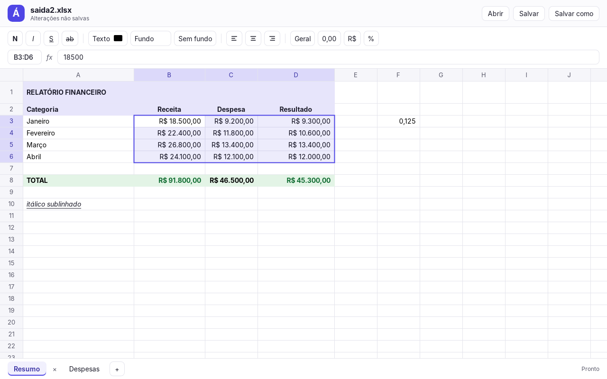

# Abacus

Suíte de escritório de código aberto, começando pela planilha. O aplicativo
desktop usa [Tauri](https://tauri.app) e o motor de cálculo é o
[IronCalc](https://www.ironcalc.com), ambos em Rust.

O Abacus usa um [fork do IronCalc](https://github.com/tamadeu/IronCalc/tree/abacus)
que acrescenta o português do Brasil: nomes de função (`SOMA`, `SE`,
`PROCV`), erros (`#NOME?`), números e datas no formato brasileiro e `R$`
como moeda.



## Estado atual

Projeto no início. O que já funciona:

- Abrir e salvar arquivos `.xlsx` (Ctrl+O, Ctrl+S, Ctrl+Shift+S), com aviso
  antes de descartar alterações não salvas, inclusive ao fechar a janela.
- Importar e exportar CSV: ao abrir, o separador (`;`, tabulação ou `,`) e a
  codificação (UTF-8 ou Windows-1252) são detectados; ao salvar como `.csv`,
  sai só a planilha ativa, com os valores como aparecem, separados por `;`.
- Gráficos de colunas, barras, linhas e pizza (aba Inserir): vêm da seleção
  ou da tabela em volta da célula ativa e acompanham os valores. Arraste para
  mover, use a alça do canto para redimensionar, Delete para apagar; dois
  cliques (ou botão direito) abrem título, tipo e intervalo de dados. Vão para
  o `.xlsx` como gráficos nativos do Excel e voltam ao abrir o arquivo.
- Formatação condicional (aba Dados): regras de valor (maior, menor, igual,
  entre…), de texto (contém, começa com…), duplicados, únicos, vazias, acima ou
  abaixo da média, maiores e menores, escalas de duas ou três cores e barras
  de dados. Dá para criar, editar e excluir; a regra entra no desfazer e é
  gravada no `.xlsx` como a do Excel.
- Validação de dados (aba Dados): lista suspensa (itens escritos ou um
  intervalo), número inteiro, decimal e tamanho do texto, com condição
  (entre, maior que…) e aviso próprio. Ao digitar, o valor recusado abre um
  aviso e a célula continua em edição; a célula com lista mostra uma seta. As
  regras vão para o `.xlsx` e voltam ao abrir.
- Barra de status com média, contagem e soma da seleção.
- A coluna alarga sozinha quando o número digitado não cabe.
- Atalhos de navegação: Ctrl+setas, Ctrl+Home, Ctrl+End, Home, PageUp e
  PageDown (com Shift estendem a seleção).
- Várias planilhas por arquivo: criar, renomear (dois cliques na aba) e
  excluir, com fórmulas entre planilhas.
- Grade desenhada em canvas, com rolagem e seleção de uma célula ou de um
  intervalo, por mouse ou teclado (Shift+setas). Clicar num cabeçalho
  seleciona a coluna ou a linha inteira, e arrastar além da borda rola a
  planilha.
- Formatação pela barra de ferramentas: negrito, itálico, sublinhado,
  tachado, tamanho da fonte, cor do texto, cor de fundo, alinhamento
  horizontal e vertical e formato numérico
  (geral, duas casas, moeda, porcentagem), com Ctrl+B, Ctrl+I e Ctrl+U.
- Larguras de coluna e alturas de linha: vêm do arquivo, mudam arrastando a
  borda do cabeçalho, e dois cliques na borda ajustam a coluna ao conteúdo.
- Células mescladas, bordas e quebra de texto: aparecem como no arquivo e
  podem ser aplicadas pela barra de ferramentas. A linha cresce sozinha
  quando o texto quebrado não cabe.
- Inserir e excluir linhas e colunas pelo menu do botão direito, que também
  tem recortar, copiar e colar.
- Edição direto na célula (digitando, com F2 ou com dois cliques) e pela
  barra de fórmulas; Enter, Tab e as setas gravam, Esc cancela e Delete apaga
  a seleção.
- Ao escrever uma fórmula, os intervalos citados ficam coloridos na grade,
  clicar ou arrastar nas células insere a referência, e uma lista sugere as
  funções que começam com o que foi digitado (Tab aceita).
- Alça de preenchimento no canto da seleção: arrastar continua sequências
  (1, 2, 3…) e copia fórmulas ajustando as referências.
- Copiar, recortar e colar (Ctrl+C, Ctrl+X, Ctrl+V). Dentro do Abacus a
  colagem leva fórmulas, com as referências ajustadas, e estilos; a área de
  transferência do sistema recebe e aceita texto separado por tabulações,
  para trocar dados com outros programas.
- Desfazer e refazer (Ctrl+Z, Ctrl+Y).
- Faixa de opções em abas, como no Excel: Página Inicial (área de
  transferência, fonte, alinhamento e número), Inserir (linhas e colunas),
  Dados (classificar, filtrar, localizar e substituir) e Exibir (congelar
  painéis, ocultar e reexibir). O menu do botão direito ficou só com o que
  se usa direto na célula.
- Localizar e substituir (Ctrl+F e Ctrl+H): sem diferenciar maiúsculas, nas
  células com o texto digitado ou mostrado, com as encontradas destacadas, e
  "Substituir tudo" desfeito num passo só. Fórmulas só são alteradas no que
  foi digitado, nunca no resultado.
- Congelar painéis, ocultar e reexibir linhas e colunas (menu de contexto):
  a parte congelada fica fixa na rolagem e tudo isso é gravado no `.xlsx`.
- Classificar de A a Z ou de Z a A pela coluna da célula ativa (a seleção, ou
  a tabela em volta, mantendo o cabeçalho; as fórmulas acompanham a linha) e
  filtrar uma coluna por valores. Filtros de colunas diferentes se somam.
- As fórmulas e funções do IronCalc, com os nomes do Excel em português,
  incluindo `LET`, `LAMBDA` e matrizes dinâmicas. Arquivos `.xlsx` continuam
  compatíveis: no arquivo as funções ficam gravadas em inglês, como no Excel.
- Números, datas e moeda no formato brasileiro (`18.500,00`, `14/11/2026`,
  `R$ 10,50`).

Limitações conhecidas:

- Os nomes em português de algumas funções muito recentes do Excel
  (`MAPA`, `REGEX.TESTAR`, `PORCENTAGEMDE`, `APARARINTERVALO`) vieram da
  documentação da Microsoft e não foram conferidos num Excel em português.
- Não há zoom.
- CSV não guarda formatação nem várias planilhas.
- As referências coloridas aparecem na grade, mas não no texto da fórmula.
- A lista de funções sugere só os nomes, sem descrição nem argumentos.
- Clicar para inserir referência só funciona dentro da mesma planilha.
- Colar para outros programas leva só os valores, sem formatação.
- O tipo de fonte do arquivo ainda não aparece na grade.
- Formatação condicional: regras por fórmula, por período e conjuntos de ícones
  continuam no arquivo, mas o Abacus não as desenha nem edita (só exclui as
  que ele não edita); "10 maiores" é só por posição, não por porcentagem.
- Validação de dados: só vale ao digitar (colar e preencher não conferem),
  não entra no desfazer e não acompanha linhas e colunas inseridas; regras de
  data, hora e fórmula somem ao salvar. Itens de lista não podem ter vírgula.
- Gráficos: só colunas, barras, linhas e pizza (os de outros tipos, como
  dispersão ou área, somem ao salvar); ficam presos a células, então não
  acompanham linhas e colunas inseridas ou excluídas; criar, mover ou apagar
  um gráfico não entra no desfazer; empilhados viram agrupados.
- As bordas aplicadas pela barra são sempre finas e pretas; as do arquivo
  aparecem com cor e espessura, mas a dupla é desenhada como grossa.
- Bordas e mesclagem não funcionam numa linha ou coluna inteira.
- O filtro é feito ocultando linhas, como "Ocultar linhas": não há setas no
  cabeçalho nem filtro por condição (maior que, contém…), e o arquivo não
  guarda a configuração de filtro, só as linhas ocultas.
- Classificar não aceita várias colunas de critério nem linhas ocultas no
  intervalo.
- Arquivos gerados pela biblioteca openpyxl mostram `0` em células vazias que
  só têm estilo. É um defeito do importador do IronCalc com células gravadas
  como `t="n"` sem valor; arquivos no formato que o Excel grava não têm o
  problema.

## Estrutura

| Pasta | Conteúdo |
| --- | --- |
| `apps/desktop/src` | Interface em TypeScript (Vite). |
| `apps/desktop/src-tauri` | Casca Tauri. `engine.rs` é a ponte com o IronCalc. |

A interface fala com o motor apenas pela interface `Engine`
(`apps/desktop/src/engine.ts`). Hoje ela chama comandos do Tauri; a versão web
vai implementar a mesma interface com o IronCalc compilado para WebAssembly.

## Como rodar

Pré-requisitos: [Rust](https://rustup.rs), Node.js 20 ou mais novo e as
[dependências de sistema do Tauri](https://tauri.app/start/prerequisites/).

```sh
cd apps/desktop
npm install
npm run tauri dev
```

`npm run dev` abre só a interface no navegador, sem o motor de cálculo, o que
serve para trabalhar no visual.

Testes, a partir da raiz:

```sh
cargo test
```

## Próximos passos

1. Propor o português do Brasil ao IronCalc original.
2. Versão web com o motor em WebAssembly.
3. Tabelas dinâmicas.

## Licença

[MIT](LICENSE). O IronCalc e o Tauri, de que o Abacus depende, são
distribuídos sob MIT ou Apache-2.0.
